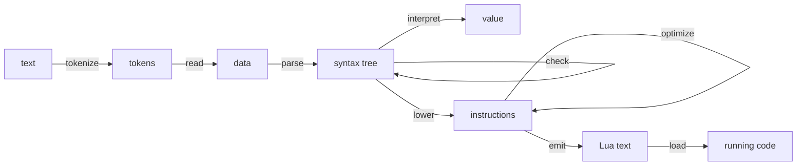

# Writing compilers in Mua

**A guide to writing compilers, interpreters and other language tools in Mua.** It builds one
compiler from text to running Lua, stage by stage, and stops at each stage to say what the
stage is for, what Mua offers it, and what to watch for. [The language](syntax.md) owns the
rules; [Designing and writing Mua](designing-and-writing-mua.md) owns the general design
method, which this guide applies to one kind of program.

A compiler is the program Mua is best at, for a reason worth stating first: a compiler is a
**closed set of shapes** (the kinds of syntax, the kinds of instruction) with an **open set of
operations** over them (checking, interpreting, lowering, optimizing, printing, emitting), and
Mua has a word for each side. `family` closes a set of `struct` kinds; a pass is a vocabulary of
handlers keyed by kind, checked against the family when it is made; vocabularies compose by
spread. The rest of this guide is that idea worked out.

The `lua` blocks below form one program, read top to bottom: `tests/guide.lua` translates and
runs them together, so a later block uses what an earlier one defined, and each is written as
`mua fmt` writes it. `examples/lisp.mua` is a shorter relative of the same compiler, without
source positions or collected problems.

* **Part I** (§1–§4) is the vocabulary: the shape of a compiler, and the tools it is built from
  (families, passes, state).
* **Part II** (§5–§12) builds the compiler: reading, parsing, checking, interpreting, lowering,
  optimizing, emitting, and testing.
* **Part III** (§13–§17) is judgment: names, performance, open and closed sets, languages
  beyond a Lisp, and what this approach still lacks.

## 0. Forms this guide relies on

| Form | Used for |
|---|---|
| `family "description"` … `Family { KindA, KindB }` | a closed set of struct kinds, declared first, sealed once its structs exist (§3) |
| `struct { field: Type }` | one kind: a nominal record with checked fields |
| `Family.pass "description" with … end` | a function over the family: one handler per kind, checked when it is made (§4) |
| `define … end` | a vocabulary: the handlers of a pass, shared and extended by spread |
| `..Base` and an explicit entry | composition: a spread contributes entries, an explicit entry overrides; two spreads that offer one name clash unless an entry names it |
| `checker("name", test)` | a named predicate, for contracts the built-ins do not cover (§3.3) |
| `meta { index = … }` | a metatable from a vocabulary; here, scopes that fall back to the scope around them (§7) |
| `load(text, name)` | running the Lua a compiler emits (§11) |

## Part I: the vocabulary

## 1. The shape of a compiler

A compiler is a pipeline of representations. Each stage reads one and writes the next:



Three decisions shape everything else:

1. **Every representation is data.** A stage's output can be printed, compared, stored and fed
   to a test without running the stages after it. That is what makes a compiler debuggable:
   when the output is wrong, you look at each representation in turn until one is.
2. **Each representation is a closed set of kinds.** The syntax has so many kinds of
   expression; the instructions, so many kinds of instruction. Adding a kind is a language
   change, and every operation must learn it. A `family` makes that a checked fact (§3).
3. **Operations are open.** New passes arrive all the time: a new check, an optimization, a
   printer for debugging, a second back end. A pass is a vocabulary, so a new one never edits the
   kinds or the other passes (§4).

The second and third points are the two sides of the *expression problem*: in most languages
either new kinds or new operations are cheap, and the other is expensive. Here kinds are
deliberately expensive (each pass is told when one is missing) and operations are cheap (a
vocabulary and a word).

## 2. Stages, and where state lives

A stage is a function from one representation to the next. Inside a stage, the work is a walk
over a tree, and the walk usually needs **state**: the names in scope, the code being written,
a supply of fresh names, the problems found so far. There are two places to put it:

* **passed down**, as an argument the walk hands to each child: a scope, which an inner node
  extends without the outer one seeing it;
* **shared**, in a table every node of the walk writes to: the code being written, the problems
  found.

Passes take both (§4.3): the arguments a pass is called with are passed on to each handler, and a
handler passes them, changed or not, to the calls it makes for its children. Keep the two kinds
apart in your head: an extended scope is a new value, a list of problems is one shared value
that grows. Name each for its role (`scope`, `problems`, `lowering`), never `ctx`: the name is
how a reader tells which kind it is.

## 3. Families: closed sets of kinds

### 3.1 Declaring a family

A family is declared first, so that its structs' fields can be typed with it, and sealed with
its kinds once they exist. Its name is a description: it appears in messages, so write what a
reader of an error should see.

```lua
-- a family of two kinds, to show the mechanism; the compiler's own families follow in §6 and §9
local Shape = family "shape"
local Circle = struct { radius: Number }
local Pair = struct { left: Shape, right: Shape }
Shape { Circle, Pair }

local two_circles = Pair { left = Circle { radius = 1 }, right = Circle { radius = 2 } }
assert(Shape.is(two_circles, Pair) and not Shape.is(two_circles, Circle))
assert(table.concat(Shape.kinds, " ") == "Circle Pair")
```

The family is a checker: a field typed `Shape` refuses anything that is not one of its kinds,
and says so with the description:

```lua
local built, message = pcall(Pair, { left = Circle { radius = 1 }, right = 5 })
assert(not built and message:find("expects shape", 1, true))
```

`Shape.is(node, Kind)` asks a kind, and asking about a struct that is not a kind of the family is
an error rather than `false`, so a misspelled kind cannot quietly answer no.

### 3.2 Kinds are structs

Each kind is an ordinary `struct`: closed (a misspelled field is an error where the node is
built), typed (each field is checked), and nominal (a `Circle` is not a `Pair` with the same
fields). Build nodes only through their struct, and the tree is valid by construction: there is
no node of a kind the family does not know, and no field holding the wrong kind of thing.

Two habits pay off from the start:

* **Give every syntax node its source position** (an `at` field). Every later error needs one,
  and adding it afterwards touches every constructor.
* **Keep nodes free of behavior.** The operations live in passes; a node is its fields. That is
  what lets a node be printed, compared and rebuilt with a spread.

### 3.3 Lists of nodes

A struct field typed `Table` accepts any table. A list of nodes is better described with a
named checker, which `checker` makes from a predicate; `check(Type, value)` asks any checker:

```lua
-- a list whose every element passes the element type, named for messages
local list_of =: element_type
    local every =: value
        if type value ~= "table" then return false end
        for _, element in ipairs value do
            if not check(element_type, element) then return false end
        end
        return true
    end
    return checker("list of " .. tostring element_type, every)
end
```

A checker that walks a list costs a pass over the list each time a node is built. That is cheap
for a compiler's trees; §14 says how to turn contracts off where it is not.

## 4. Passes: operations over a family

### 4.1 A pass is a vocabulary checked against the family

`Family.pass "description" handlers` returns a function over the family's values. `handlers` has
one entry per kind, keyed by the struct's name. It is checked when the pass is made: a kind with
no handler, a handler for a name that is no kind, and a handler that is not a function are errors
that name them. So a pass that compiles has a handler for every kind, and a new kind makes every
pass that has not learned it fail where it is made, not when some program first uses the kind.

```lua
local Area = define
    Circle =: node recurse
        return 3 * node.radius * node.radius
    end
    Pair =: node recurse
        return recurse node.left + recurse node.right
    end
end
local area = Shape.pass "area" with ..Area end
assert(area two_circles == 15)

local made, why = pcall(Shape.pass "area", { Circle = Area.Circle })
assert(not made and why:find("no handler for the kind 'Pair'", 1, true))
```

A handler is called as `handler(node, recurse, ...)`: the node it is given, the pass itself (to
recur with), and the arguments the pass was called with. Every handler in this guide spells it
that way, `Circle =: node recurse`, whatever the pass: the contract reads the same in every pass,
so a handler never has to be decoded, and `recurse node.left` says what happens. The pass's own
name (`area`, `check`, `evaluate`) belongs to the place it is called from.

### 4.2 Answers and effects

A pass either **answers** (each handler returns something: a value, a node, a line of text) or
**acts** (each handler changes shared state and returns nothing). The compiler below has both:
the interpreter answers values, lowering answers registers and writes instructions, the checker
acts on a list of problems. Decide which a pass is before writing it, and keep it one or the
other; a handler that answers in one kind and acts in another is a bug waiting to happen.

### 4.3 Carrying state down the tree

The arguments a pass is called with follow the node to every handler. A handler passes them on
in its own calls, changed or not:

```lua
local Depth = define
    Circle =: node recurse depth
        return depth
    end
    Pair =: node recurse depth
        return math.max(recurse(node.left, depth + 1), recurse(node.right, depth + 1))
    end
end
local depth_of = Shape.pass "depth" with ..Depth end
assert(depth_of(two_circles, 0) == 1)
```

### 4.4 Composing passes

Because handlers are a vocabulary, passes are built from one another by spread:

* **A base and its variants.** A shared base is spread in, and each variant names only the kinds
  it changes. The optimizer (§10) is five passes over one base that answers every instruction
  with itself.
* **An explicit entry overrides a spread.** That is the way to say "this pass does what that one
  does, except here".
* **Two spreads that offer the same kind clash** (`spread-overlap`) unless the block names that
  kind itself. Combining two passes that both handle a kind is a decision, and the clash makes
  you write it down.
* **A handler cannot be removed with `nil`**: in Lua, `nil` is absence, so `{ ..Base, Kind = nil }`
  keeps the base's handler. Copy the vocabulary and delete the entry, and the pass will tell you
  the kind is now missing.

```lua
-- a variant that names only what it changes
local RoundedArea = define ..Area
    Circle =: node recurse
        return math.floor(3.14159 * node.radius * node.radius)
    end
end
local rounded_area = Shape.pass "rounded area" with ..RoundedArea end
assert(rounded_area two_circles == 15)
```

## Part II: building a compiler

The language is a small Lisp: numbers, names, `(+ a b)` and the other binary operators,
`(if condition when-true when-false)`, `(let ((name value) …) body)` (a binding sees itself, so a
function can recur), `(lambda (name …) body)`, applications, and a program of
`(define name value)` forms ending in an expression. The target is Lua text.

## 5. Reading text

### 5.1 Tokens carry positions

The tokenizer is the one place that knows where things are in the text. Every token records its
position, as `source:line:column`, and every stage after it passes positions on.

```lua
local Token = struct { text: String, at: String }

local tokenize =: text source_name
    local tokens, index, line, line_start = {}, 1, 1, 1
    while index <= #text do
        local character = text:sub(index, index)
        if character == "\n" then
            line, line_start = line + 1, index + 1
            index += 1
        elseif character:match "%s" then
            index += 1
        elseif character == ";" then
            -- a comment runs to the end of its line
            index = text:find("\n", index, true) or #text + 1
        else
            local last = index
            if character ~= "(" and character ~= ")" then
                local boundary = text:find("[%s();]", index) or #text + 1
                last = boundary - 1
            end
            local at = ("%s:%d:%d"):format(source_name, line, index - line_start + 1)
            tokens[#tokens + 1] = Token { text = text:sub(index, last), .at }
            index = last + 1
        end
    end
    return tokens
end
```

### 5.2 Reading into data

A Lisp reads in two steps: tokens to *data* (atoms and lists), then data to syntax (§6). The
first step knows only brackets; the second knows the language. Keeping them apart means the
reader never changes when the language does. The data are a family too, so the parser can ask
`Datum.is`.

```lua
local Datum = family "datum"
local Atom = struct { text: String, at: String }
local List = struct { items: Table, at: String }
Datum { Atom, List }

-- a problem at a position: every stage that stops reports this way
local fail = |at, message| -> error(at .. ": " .. message, 0)

local read =: tokens
    local position = 1
    local read_datum
    read_datum = do()
        local token = tokens[position]
        position += 1
        if token.text == ")" then fail(token.at, "this ) closes nothing") end
        if token.text ~= "(" then return Atom { text = token.text, at = token.at } end
        local items = {}
        while true do
            local next_token = tokens[position]
            if next_token == nil then fail(token.at, "this ( is never closed") end
            if next_token.text == ")" then break end
            items[#items + 1] = read_datum()
        end
        position += 1
        return List { .items, at = token.at }
    end
    local forms = {}
    while tokens[position] do forms[#forms + 1] = read_datum() end
    return forms
end
```

The error names the opening bracket's position, not the end of the text: the place to fix is
where the list began.

## 6. The syntax tree, and parsing

### 6.1 The family

```lua
local Expression = family "expression"
local Expressions = list_of Expression
local Literal = struct { value: Number, at: String }
local Variable = struct { name: String, at: String }
local Primitive = struct { operator: String, arguments: Expressions, at: String }
local Conditional = struct
    condition: Expression
    when_true: Expression
    when_false: Expression
    at: String
end
local Let = struct { name: String, value: Expression, body: Expression, at: String }
local Lambda = struct { parameters: Table, body: Expression, at: String }
local Application = struct { callee: Expression, arguments: Expressions, at: String }
Expression { Literal, Variable, Primitive, Conditional, Let, Lambda, Application }

-- the operators the language knows, and what each means
local operators = {
    ["+"] = |left, right| -> left + right,
    ["-"] = |left, right| -> left - right,
    ["*"] = |left, right| -> left * right,
    ["<"] = |left, right| -> left < right,
    ["="] = |left, right| -> left == right,
}
```

The kinds are named for what they are, in full: an `if` is a `Conditional` with a `condition`, a
`when_true` and a `when_false`; a call is an `Application` of a `callee` to `arguments`. Every
handler of every pass below reads with these words.

Two design choices are visible here. `let` desugars to nested `Let` nodes of one binding each, so
the rest of the compiler meets one form instead of two. And `operators` is a table of meanings
shared by the parser (which operators exist), the interpreter (what they do) and the optimizer
(what they compute when the operands are known): one definition, three uses.

### 6.2 Parsing data into the family

Parsing is a function over data, not a pass: what a list means depends on its first element, not
on its kind. Each form checks its own shape and fails at its own position.

```lua
local parse
parse =: datum
    if Datum.is(datum, Atom) then
        local number = tonumber datum.text
        if number then return Literal { value = number, at = datum.at } end
        return Variable { name = datum.text, at = datum.at }
    end
    local items = datum.items
    if #items == 0 then fail(datum.at, "() is not an expression") end
    local head = Datum.is(items[1], Atom) and items[1].text
    if head == "if" then
        if #items ~= 4 then
            fail(datum.at, "(if condition when-true when-false) takes three parts")
        end
        return Conditional with
            condition = parse items[2]
            when_true = parse items[3]
            when_false = parse items[4]
            at = datum.at
        end
    end
    if head == "let" then
        if #items ~= 3 or not Datum.is(items[2], List) then fail(datum.at,
                "a let is (let ((name value) …) body)") end
        local body = parse items[3]
        local bindings = items[2].items
        for index = #bindings, 1, -1 do
            local binding = bindings[index]
            if not Datum.is(binding, List) or #binding.items ~= 2 or not Datum.is(binding.items[1],
                Atom) then
                fail(binding.at, "a binding is (name value)")
            end
            body = Let with
                name = binding.items[1].text
                value = parse binding.items[2]
                .body
                at = binding.at
            end
        end
        return body
    end
    if head == "lambda" then
        if #items ~= 3 or not Datum.is(items[2], List) then fail(datum.at,
                "a lambda is (lambda (name …) body)") end
        local parameters = {}
        for index, parameter in ipairs items[2].items do
            if not Datum.is(parameter, Atom) then fail(parameter.at, "a parameter is a name") end
            parameters[index] = parameter.text
        end
        return Lambda { .parameters, body = parse items[3], at = datum.at }
    end
    local arguments = {}
    for index = 2, #items do arguments[#arguments + 1] = parse items[index] end
    if operators[head] then return Primitive { operator = head, .arguments, at = datum.at } end
    return Application { callee = parse items[1], .arguments, at = datum.at }
end

-- is the datum this symbol?
local is_symbol = |datum, text| -> Datum.is(datum, Atom) and datum.text == text

-- a program: (define name value) forms, then the expression they are for
local parse_program =: forms
    if #forms == 0 then error("parse: an empty program", 0) end
    local body = parse forms[#forms]
    for index = #forms - 1, 1, -1 do
        local form = forms[index]
        local items = Datum.is(form, List) and form.items
        local defines = items and #items == 3 and is_symbol(items[1], "define")
        if not defines then
            fail(form.at, "only the last form of a program may be an expression")
        end
        body = Let { name = items[2].text, value = parse items[3], .body, at = form.at }
    end
    return body
end
```

Parsing reports the **first** problem and stops: a malformed form says nothing reliable about
what follows it. Checking (§7) can do better.

### 6.3 Printing the tree back

The first pass to write over a new family is the one that prints it. It is how every other
stage is debugged, and it gives the tree a round-trip test: printing a parsed program and reading
the print must give the same tree.

```lua
local Writing = define
    Literal =: node recurse
        return tostring node.value
    end
    Variable =: node recurse
        return node.name
    end
    Primitive =: node recurse
        local left, right = recurse node.arguments[1], recurse node.arguments[2]
        return ("(%s %s %s)"):format(node.operator, left, right)
    end
    Conditional =: node recurse
        local condition = recurse node.condition
        local when_true, when_false = recurse node.when_true, recurse node.when_false
        return ("(if %s %s %s)"):format(condition, when_true, when_false)
    end
    Let =: node recurse
        return "(let ((" .. node.name .. " " .. recurse node.value .. ")) " .. recurse node.body .. ")"
    end
    Lambda =: node recurse
        local parameters = table.concat(node.parameters, " ")
        return ("(lambda (%s) %s)"):format(parameters, recurse node.body)
    end
    Application =: node recurse
        local parts = { recurse node.callee }
        for _, argument in ipairs node.arguments do parts[#parts + 1] = recurse argument end
        return "(" .. table.concat(parts, " ") .. ")"
    end
end
local write_expression = Expression.pass "write an expression as text" with ..Writing end

local parsed = parse_program(read(tokenize("(let ((x 2)) (* x (+ x 1)))", "round-trip")))
local written = write_expression parsed
assert(written == "(let ((x 2)) (* x (+ x 1)))")
assert(write_expression(parse_program(read(tokenize(written, "written again")))) == written)
```

## 7. Checking

### 7.1 Scopes that fall back

A checker walks the tree carrying the names in scope. Entering a `let` or a `lambda` makes an
inner scope; leaving it must restore the outer one. Copying the whole scope at each entry works
but costs a copy per binding. A scope that **falls back** to the one around it costs nothing:
`meta { index = outer }` makes a metatable whose `__index` is the outer scope, so a name missing
from the inner table is looked up outside.

```lua
-- a scope whose missing names are those of the scope around it
local within = outer -> meta { index = outer } {}
local scope_with =: outer names
    local inner = within outer
    for _, name in ipairs names do inner[name] = true end
    return inner
end

local outer_scope = scope_with({}, { "x" })
local inner_scope = scope_with(outer_scope, { "y" })
assert(inner_scope.x and inner_scope.y and not outer_scope.y)
```

The same scopes serve the interpreter (§8), holding values instead of `true`.

### 7.2 Collecting problems

A checker should report **every** problem it can, not the first: a programmer fixing a program
wants the whole list. So the checker acts on a shared list of problems instead of raising an
error, and the compiler stops after checking if the list is not empty. The scope is passed down
(each handler may extend it); the list is shared (every handler appends to the same one).

```lua
local report =: problems at message
    problems[#problems + 1] = at .. ": " .. message
end

local Checking = define
    Literal =: node recurse scope problems
        return
    end
    Variable =: node recurse scope problems
        if not scope[node.name] then report(problems,
                node.at, node.name .. " is not defined here") end
    end
    Primitive =: node recurse scope problems
        if #node.arguments ~= 2 then
            local message = ("(%s) takes two arguments, got %d"):format(node.operator,
                #node.arguments)
            report(problems, node.at, message)
        end
        for _, argument in ipairs node.arguments do recurse(argument, scope, problems) end
    end
    Conditional =: node recurse scope problems
        recurse(node.condition, scope, problems)
        recurse(node.when_true, scope, problems)
        recurse(node.when_false, scope, problems)
    end
    Let =: node recurse scope problems
        local inner = scope_with(scope, { node.name })
        recurse(node.value, inner, problems)
        recurse(node.body, inner, problems)
    end
    Lambda =: node recurse scope problems
        recurse(node.body, scope_with(scope, node.parameters), problems)
    end
    Application =: node recurse scope problems
        recurse(node.callee, scope, problems)
        for _, argument in ipairs node.arguments do recurse(argument, scope, problems) end
    end
end
local check = Expression.pass "check names and arity" with ..Checking end

local problems = {}
check(parse_program(read(tokenize("(+ x (* 1))", "two problems"))), {}, problems)
assert(#problems == 2)
assert(problems[1] == "two problems:1:4: x is not defined here")
assert(problems[2] == "two problems:1:6: (*) takes two arguments, got 1")
```

The problems arrive in the order of the walk, which is the order of the text. Both were found in
one run: the unknown `x`, and the `(*)` with one argument. A checker that stopped at the first
would have made the programmer run it twice.

A checker is also where a language's static rules live as it grows: types, mutability, effects.
Each is a pass of its own, or richer state in this one; none of them needs the others to change.

## 8. A reference interpreter

Before compiling anything, write an interpreter: a pass that answers the value of each node. It
is short, obviously right, and it becomes the **reference** every compiled program is compared
with (§12). A compiler without one can only be tested against expected outputs written by hand.

```lua
local Evaluation = define
    Literal =: node recurse environment
        return node.value
    end
    Variable =: node recurse environment
        return environment[node.name]
    end
    Primitive =: node recurse environment
        local left = recurse(node.arguments[1], environment)
        local right = recurse(node.arguments[2], environment)
        return operators[node.operator](left, right)
    end
    Conditional =: node recurse environment
        if recurse(node.condition, environment) then
            return recurse(node.when_true, environment)
        end
        return recurse(node.when_false, environment)
    end
    Let =: node recurse environment
        local inner = within environment
        inner[node.name] = recurse(node.value, inner)
        return recurse(node.body, inner)
    end
    Lambda =: node recurse environment
        return do(..arguments)
            local inner = within environment
            for index, name in ipairs node.parameters do inner[name] = arguments[index] end
            return recurse(node.body, inner)
        end
    end
    Application =: node recurse environment
        local arguments = {}
        for index, argument in ipairs node.arguments do
            arguments[index] = recurse(argument, environment)
        end
        return recurse(node.callee, environment)(unpack arguments)
    end
end
local evaluate = Expression.pass "evaluate an expression" with ..Evaluation end

local factorial = "(define fact (lambda (n) (if (< n 2) 1 (* n (fact (- n 1)))))) (fact 5)"
assert(evaluate(parse_program(read(tokenize(factorial, "factorial"))), {}) == 120)
```

`Let` binds the name in the inner environment *before* evaluating the value into it, so a
`lambda` bound by a `let` sees itself: that is the whole of recursion here. The interpreter
decides the semantics; the compiler's job is to agree with it, faster.

## 9. Lowering to an intermediate form

### 9.1 Why a second family

The syntax tree is the language as written: nested, with names. A back end wants the program as
it runs: a sequence of simple steps, with every intermediate value named. The **intermediate
form** is a second family, chosen so that optimizations and emission are easy:

* **registers**: every value has a name, written where it is computed;
* **flat code**: each function is one list of instructions, with labels and jumps for control;
* **closures** hold the code of the function they create.

```lua
local Instruction = family "instruction"
local Constant = struct { register: String, value: Any }
local Copy = struct { register: String, source: String }
local Operation = struct { register: String, operator: String, left: String, right: String }
local Call = struct { register: String, callee: String, arguments: Table }
local Label = struct { name: String }
local Jump = struct { label: String }
local JumpUnless = struct { condition: String, label: String }
local Return = struct { source: String }
local Closure = struct { register: String, parameters: Table, code: Table }
Instruction { Constant, Copy, Operation, Call, Label, Jump, JumpUnless, Return, Closure }
```

Write down the intermediate form's **invariants**, because the optimizer will rely on them and a
later change to lowering can break them silently. Here: jumps only go forward (there are no
loops, only recursion through calls); a label is reached by a jump or by falling through; a
register named by a `let` or a conditional may be written in more than one place, every other
register exactly once.

### 9.2 The lowering state

Lowering is a pass over the *syntax* family that writes *instructions*. Its state holds the code
being written, the register each name stands for, and a supply of fresh names. A handler answers
the register holding its node's value.

Fresh names are made from a word that says what the register holds, so the emitted Lua reads:
`value_3` is an intermediate value, `fact_7` the register of the name `fact`, `otherwise_4` a
label. A source name may hold characters Lua does not allow in a name, so they are replaced.

```lua
local fresh_names = do()
    local count = 0
    return: word
        count += 1
        return word:gsub("[^%w_]", "_") .. "_" .. count
    end
end

local write_instruction =: lowering instruction
    lowering.code[#lowering.code + 1] = instruction
end
```

A nested scope is lowering state whose names fall back to the outer ones, and a function body is
state with its own code list: both are a spread of the outer state with a field replaced. The
fresh-name supply is shared by all of them, so names never collide across functions.

### 9.3 The lowering pass

```lua
local Lowering = define
    Literal =: node recurse lowering
        local register = lowering.fresh "value"
        write_instruction(lowering, Constant { .register, value = node.value })
        return register
    end
    Variable =: node recurse lowering
        return lowering.registers[node.name]
    end
    Primitive =: node recurse lowering
        local left = recurse(node.arguments[1], lowering)
        local right = recurse(node.arguments[2], lowering)
        local register = lowering.fresh "value"
        local operator = node.operator
        write_instruction(lowering, Operation { .register, .operator, .left, .right })
        return register
    end
    Conditional =: node recurse lowering
        local condition = recurse(node.condition, lowering)
        local otherwise = lowering.fresh "otherwise"
        local done = lowering.fresh "done"
        local register = lowering.fresh "value"
        write_instruction(lowering, JumpUnless { .condition, label = otherwise })
        write_instruction(lowering,
            Copy { .register, source = recurse(node.when_true, lowering) })
        write_instruction(lowering, Jump { label = done })
        write_instruction(lowering, Label { name = otherwise })
        write_instruction(lowering,
            Copy { .register, source = recurse(node.when_false, lowering) })
        write_instruction(lowering, Label { name = done })
        return register
    end
    Let =: node recurse lowering
        local register = lowering.fresh node.name
        local inner = { ..lowering, registers = within lowering.registers }
        inner.registers[node.name] = register
        write_instruction(lowering, Copy { .register, source = recurse(node.value, inner) })
        return recurse(node.body, inner)
    end
    Lambda =: node recurse lowering
        local inner = { ..lowering, code = {}, registers = within lowering.registers }
        local parameters = {}
        for index, name in ipairs node.parameters do
            parameters[index] = lowering.fresh name
            inner.registers[name] = parameters[index]
        end
        write_instruction(inner, Return { source = recurse(node.body, inner) })
        local register = lowering.fresh "lambda"
        write_instruction(lowering, Closure { .register, .parameters, code = inner.code })
        return register
    end
    Application =: node recurse lowering
        local callee = recurse(node.callee, lowering)
        local arguments = {}
        for index,
        argument in ipairs node.arguments do arguments[index] = recurse(argument, lowering) end
        local register = lowering.fresh "value"
        write_instruction(lowering, Call { .register, .callee, .arguments })
        return register
    end
end
local lower = Expression.pass "lower an expression to instructions" with ..Lowering end

-- a whole program is the body of a function with no parameters
local lower_program =: tree
    local lowering = { code = {}, registers = {}, fresh = fresh_names() }
    write_instruction(lowering, Return { source = lower(tree, lowering) })
    return lowering.code
end
```

Read `Conditional` as the template for control flow: evaluate the condition, jump over the branch
that does not run, copy each branch's value into one register, and meet at a label. Every
structured construct lowers to this pattern of labels and jumps.

`Let` writes its register *after* lowering the value, but the value's code already refers to the
register (a recursive call does): the emitted Lua declares every register at the top of its
function (§11), so a closure can capture a register before it is written.

## 10. Optimizing

### 10.1 Rewrites and walks

An optimization is a pass over the instruction family. Two drivers cover them all:

* a **rewrite** answers each instruction with the list of instructions that replace it (none to
  delete it, one to keep or change it, several to expand it);
* a **walk** visits each instruction for its effect on shared state (counting, collecting).

```lua
local rewrite =: pass code state
    local written = {}
    state.written = written
    for _, instruction in ipairs code do
        for _, replacement in ipairs(pass(instruction, state)) do
            written[#written + 1] = replacement
        end
    end
    return written
end
local walk =: pass code state
    for _, instruction in ipairs code do pass(instruction, state) end
end
```

A rewrite exposes the code written so far as `state.written`, so a handler can look one
instruction back (§10.4 uses it).

### 10.2 The identity, and passes that change only what they name

Every rewrite starts from the identity: each instruction stands for itself. Spread in, it lets an
optimization name only the kinds it changes, and the family still checks that the result covers
every kind.

```lua
local itself = node -> { node }
local Unchanged = define
    Constant = itself
    Copy = itself
    Operation = itself
    Call = itself
    Label = itself
    Jump = itself
    JumpUnless = itself
    Return = itself
    Closure = itself
end
local nothing = do() end
```

### 10.3 Folding what is known

Along straight-line code, a register written by a `Constant` holds a known value, and an
operation on known values can be computed now. Facts are boxed (`{ value }`) because a known
value may be `false`. The invariants of §9.1 make this sound: at a **label**, control may arrive
from elsewhere, so everything known is forgotten; a function body starts knowing nothing. A
condition that is known decides its jump: a true condition never jumps, a false one always does.

```lua
local Folding = define ..Unchanged
    Constant =: node recurse facts
        facts.known[node.register] = { node.value }
        return { node }
    end
    Copy =: node recurse facts
        local known = facts.known[node.source]
        facts.known[node.register] = known
        if known then return { Constant { register = node.register, value = known[1] } } end
        return { node }
    end
    Operation =: node recurse facts
        local left, right = facts.known[node.left], facts.known[node.right]
        facts.known[node.register] = nil
        if left and right then
            local value = operators[node.operator](left[1], right[1])
            facts.known[node.register] = { value }
            return { Constant { register = node.register, .value } }
        end
        return { node }
    end
    Call =: node recurse facts
        facts.known[node.register] = nil
        return { node }
    end
    Label =: node recurse facts
        facts.known = {}
        return { node }
    end
    JumpUnless =: node recurse facts
        local condition = facts.known[node.condition]
        if condition == nil then return { node } end
        if condition[1] then return {} end
        return { Jump { label = node.label } }
    end
    Closure =: node recurse facts
        facts.known[node.register] = nil
        local code = rewrite(recurse, node.code, { known = {} })
        return { Closure { register = node.register, parameters = node.parameters, .code } }
    end
end
local fold = Instruction.pass "fold what is known" with ..Folding end
```

If the language grows loops, jumps go backwards and "forget at labels" is no longer enough: a
fact known before a loop may be changed inside it. Then folding needs a dataflow analysis over
the function's control-flow graph. The invariant written down in §9.1 is what tells you this
optimization has to change.

### 10.4 Removing what cannot run

After folding, some jumps always happen and some labels are never jumped to. Code between an
unconditional jump (or a return) and the next label that is still jumped to can never run.
Finding those labels is a walk; removing the dead code is a rewrite that carries a "dead" flag
along the code. A jump to the label right after it is no jump, which the rewrite removes by
looking back at the code it has written.

```lua
local JumpedTo = define
    Constant = nothing
    Copy = nothing
    Operation = nothing
    Call = nothing
    Label = nothing
    Return = nothing
    Jump =: node recurse labels
        labels[node.label] = true
    end
    JumpUnless =: node recurse labels
        labels[node.label] = true
    end
    Closure =: node recurse labels
        walk(recurse, node.code, labels)
    end
end
local find_labels = Instruction.pass "find the labels still jumped to" with ..JumpedTo end

local unless_dead =: node recurse flow
    if flow.dead then return {} end
    return { node }
end
local ending_the_flow =: node recurse flow
    if flow.dead then return {} end
    flow.dead = true
    return { node }
end
local Reaching = define
    Constant = unless_dead
    Copy = unless_dead
    Operation = unless_dead
    Call = unless_dead
    JumpUnless = unless_dead
    Jump = ending_the_flow
    Return = ending_the_flow
    Label =: node recurse flow
        if not flow.labels[node.name] then return {} end
        local previous = flow.written[#flow.written]
        if previous and Instruction.is(previous, Jump) and previous.label == node.name then
            flow.written[#flow.written] = nil
        end
        flow.dead = false
        return { node }
    end
    Closure =: node recurse flow
        if flow.dead then return {} end
        local code = rewrite(recurse, node.code, { labels = flow.labels })
        return { Closure { register = node.register, parameters = node.parameters, .code } }
    end
end
local reach = Instruction.pass "drop what cannot run" with ..Reaching end
```

### 10.5 Removing what nobody reads

An instruction with no effect whose register is never read can go. Counting reads is a walk;
removing is a rewrite over the identity that names the pure kinds. A call may have effects, so it
stays. Reads inside a closure count, since the closure may read a register of the function around
it.

```lua
local read_once_more =: register counts
    counts.reads[register] = (counts.reads[register] or 0) + 1
end
local Reads = define
    Constant = nothing
    Label = nothing
    Jump = nothing
    Copy =: node recurse counts
        read_once_more(node.source, counts)
    end
    Operation =: node recurse counts
        read_once_more(node.left, counts)
        read_once_more(node.right, counts)
    end
    Call =: node recurse counts
        read_once_more(node.callee, counts)
        for _, argument in ipairs node.arguments do read_once_more(argument, counts) end
    end
    JumpUnless =: node recurse counts
        read_once_more(node.condition, counts)
    end
    Return =: node recurse counts
        read_once_more(node.source, counts)
    end
    Closure =: node recurse counts
        walk(recurse, node.code, counts)
    end
end
local count_reads = Instruction.pass "count the reads of each register" with ..Reads end

local never_read =: instruction counts
    return (counts.reads[instruction.register] or 0) == 0
end
local unless_never_read =: node recurse counts
    if never_read(node, counts) then return {} end
    return { node }
end
local Sweeping = define ..Unchanged
    Constant = unless_never_read
    Copy = unless_never_read
    Operation = unless_never_read
    Closure =: node recurse counts
        if never_read(node, counts) then return {} end
        local code = rewrite(recurse, node.code, counts)
        return { Closure { register = node.register, parameters = node.parameters, .code } }
    end
end
local sweep = Instruction.pass "sweep what nobody reads" with ..Sweeping end
```

### 10.6 Running to a fixed point

One optimization exposes another: folding a condition makes a branch dead, removing it makes a
register unread, removing that makes another unread. The optimizer runs the passes in order until
the code stops shrinking, with a bound so a mistake cannot loop forever.

```lua
local instruction_count
instruction_count =: code
    local total = 0
    for _, instruction in ipairs code do
        total += 1
        if Instruction.is(instruction, Closure) then total += instruction_count instruction.code end
    end
    return total
end

local optimize =: code
    for _ = 1, 8 do
        local before = instruction_count code
        code = rewrite(fold, code, { known = {} })
        local labels = {}
        walk(find_labels, code, labels)
        code = rewrite(reach, code, { .labels })
        local counts = { reads = {} }
        walk(count_reads, code, counts)
        code = rewrite(sweep, code, counts)
        if instruction_count code == before then break end
    end
    return code
end
```

## 11. Emitting Lua

Emission is a pass over the instructions that answers text. Three facts about Lua decide its
shape:

* **`goto` may not jump into the scope of a local.** So each function declares every register it
  writes at its top, before any label, and the instructions only assign.
* **Lua's truthiness is the language's**: only `false` and `nil` are false. The Lisp here adopts
  it, so a conditional needs no translation. A language with other rules (0 is false, say) must
  emit a test that says so.
* **Operators differ in spelling**: the language's `=` is Lua's `==`.

```lua
local function_body =: write code indent
    local registers, declared = {}, {}
    for _, instruction in ipairs code do
        local register = instruction.register
        if register and not declared[register] then
            declared[register] = true
            registers[#registers + 1] = register
        end
    end
    local lines = {}
    if #registers > 0 then lines[1] = indent .. "local " .. table.concat(registers, ", ") end
    for _, instruction in ipairs code do lines[#lines + 1] = write(instruction, indent) end
    return table.concat(lines, "\n")
end

local lua_spelling = {["="] = "==" }
local LuaText = define
    Constant =: node recurse indent
        return indent .. node.register .. " = " .. tostring node.value
    end
    Copy =: node recurse indent
        return indent .. node.register .. " = " .. node.source
    end
    Operation =: node recurse indent
        local operator = lua_spelling[node.operator] or node.operator
        local expression = node.left .. " " .. operator .. " " .. node.right
        return indent .. node.register .. " = " .. expression
    end
    Call =: node recurse indent
        local arguments = table.concat(node.arguments, ", ")
        return indent .. node.register .. " = " .. node.callee .. "(" .. arguments .. ")"
    end
    Label =: node recurse indent
        return indent .. "::" .. node.name .. "::"
    end
    Jump =: node recurse indent
        return indent .. "goto " .. node.label
    end
    JumpUnless =: node recurse indent
        return indent .. "if not " .. node.condition .. " then goto " .. node.label .. " end"
    end
    Return =: node recurse indent
        return indent .. "return " .. node.source
    end
    Closure =: node recurse indent
        local header = ("%s%s = function(%s)"):format(indent,
            node.register, table.concat(node.parameters, ", "))
        local body = function_body(recurse, node.code, indent .. "  ")
        return header .. "\n" .. body .. "\n" .. indent .. "end"
    end
end
local write_lua = Instruction.pass "write an instruction as Lua" with ..LuaText end
local emit_lua = code -> function_body(write_lua, code, "")
```

The whole compiler is the stages in order. It answers every representation, not only the last,
so a test or a debugging session can look at any of them:

```lua
local compile =: text source_name
    local tree = parse_program(read(tokenize(text, source_name)))
    local problems_found = {}
    check(tree, {}, problems_found)
    if #problems_found > 0 then error(table.concat(problems_found, "\n"), 0) end
    local instructions = lower_program tree
    local optimized = optimize instructions
    return { .tree, .instructions, .optimized, lua = emit_lua optimized }
end

local run =: text source_name
    local compiled = compile(text, source_name)
    return assert(load(compiled.lua, "=" .. source_name))(), compiled
end

local folded = compile("(if (< 1 2) (+ 10 (* 2 3)) 99)", "folded")
assert(instruction_count folded.instructions == 16 and instruction_count folded.optimized == 2)
assert(folded.lua == "local value_6\nvalue_6 = 16\nreturn value_6")
```

`load` takes a chunk name: give each compiled program its own (`"=" .. source_name`), so a Lua
error in compiled code names the program it came from. The emitted text is the place to look
when a compiled program misbehaves; print it. With registers named for what they hold, it reads:

```lua
local factorial_of_ten = "(define fact (lambda (n) (if (< n 2) 1 (* n (fact (- n 1)))))) (fact 10)"
local recursion = compile(factorial_of_ten, "recursion")
assert(recursion.lua:find("fact_1 = lambda_", 1, true))
assert(recursion.lua:find "value_%d+ = fact_1%(")
```

## 12. Testing a compiler

### 12.1 Agree with the interpreter

The strongest test is **differential**: run each program both ways and require the same answer.
Every new program in the corpus tests the whole pipeline, and a disagreement points at a stage:
if the unoptimized code agrees and the optimized code does not, the optimizer is wrong.

```lua
local corpus = {
    { name = "arithmetic", source = "(+ 1 (* 2 3))", expected = 7 },
    { name = "a known branch", source = "(if (< 1 2) (+ 10 (* 2 3)) 99)", expected = 16 },
    { name = "an unknown branch",
        source = "(define f (lambda (x) (if (< x 0) (- 0 x) x))) (f (- 0 4))", expected = 4 },
    { name = "a function",
        source = "(define square (lambda (x) (* x x))) (square (+ 3 4))", expected = 49 },
    { name = "recursion",
        source = "(define fact (lambda (n) (if (< n 2) 1 (* n (fact (- n 1)))))) (fact 10)",
        expected = 3628800 },
    { name = "a closure",
        source = "(define adder (lambda (a) (lambda (b) (+ a b)))) ((adder 3) 4)", expected = 7 },
    { name = "let", source = "(let ((x 2) (y (+ x 1))) (* x y))", expected = 6 },
    { name = "equality", source = "(if (= (+ 1 1) 2) 1 0)", expected = 1 },
}
for _, program in ipairs corpus do
    local compiled_result, compiled = run(program.source, program.name)
    local unoptimized_result = assert(load(emit_lua compiled.instructions, "=" .. program.name))()
    local evaluated_result = evaluate(compiled.tree, {})
    assert(compiled_result == program.expected, program.name)
    assert(unoptimized_result == program.expected and evaluated_result == program.expected,
        program.name)
end
```

### 12.2 Refusals are part of the language

What a compiler refuses, and how it says so, is as much its behavior as what it accepts. Test the
messages, positions included:

```lua
local refusal =: text
    local accepted, message = pcall(compile, text, "refusal")
    assert(not accepted, text .. " was accepted")
    return message
end
assert(refusal "(+ 1 2" == "refusal:1:1: this ( is never closed")
assert(refusal "(if 1 2)" == "refusal:1:1: (if condition when-true when-false) takes three parts")
assert(refusal "(let ((x)) x)" == "refusal:1:7: a binding is (name value)")
assert(refusal "(f 1)" == "refusal:1:2: f is not defined here")
assert(refusal "1 2" == "refusal:1:1: only the last form of a program may be an expression")
```

### 12.3 Other tests worth having

* **Round trips.** Writing a tree as text and reading it back gives the same tree (§6.3).
* **Representations at each stage.** For a few small programs, compare the instructions before
  and after optimizing with what you expect; they are the tests that keep an optimization from
  silently stopping (the `16 -> 2` assertion in §11 is one).
* **Pass completeness.** A family checks every pass when it is made, so a new kind is caught by
  simply loading the compiler. Load it in the tests.
* **Examples with their output.** A file of programs whose expected output is a comment at the
  end, run by the test suite, documents and tests at once (Mua's `examples/` work this way).

## Part III: judgment

## 13. Names

In Mua everything is vocabulary, and a compiler has more of it than most programs: kinds, fields,
passes, states. Name all of it in full words (the design guide's §13 is the rule):

* **Kinds and fields** say what they are: `Conditional { condition, when_true, when_false }`, not
  `If { test, yes, no }`; `register`, not `dst`; `Literal`, not `Num`.
* **A handler** always spells the contract in the same words, `node recurse` and then the state
  by its role: `Let =: node recurse lowering`. Then `recurse(node.body, inner)` reads the same in
  every pass, and the kind is named once, by the entry (`Let =`).
* **A pass** is named for what it does where it is made and called: `check`, `evaluate`, `lower`,
  `fold`.
* **State** is named for its role: `scope` and `problems` in the checker, `environment` in the
  interpreter, `lowering`, `facts`, `flow`, `counts`. A reader never has to look up what a `ctx`
  holds.
* **Generated names** that people read are words too: `fact_1` for the register of `fact`,
  `value_6` for an intermediate value, `otherwise_4` for a label.

Mua is concise enough that full names cost nothing; a shorthand saves its writer a few
keystrokes and costs every reader a lookup.

## 14. Performance

* **Dispatch is cheap.** A pass finds a handler by the node's metatable: one table lookup, no
  string comparison.
* **Contracts cost.** Each struct construction checks its fields, and a `list_of` checker walks
  its list. For a compiler's own trees this is usually invisible next to the work; where it is
  not, the translator's `contracts = false` removes the checks, and the program is otherwise the
  same. Keep contracts on in tests.
* **Spreads copy.** `{ ..lowering, code = {} }` copies the state; it is meant for entering a scope
  or a function, not for every node. Scopes that fall back (§7.1) cost nothing to enter.
* **The emitted code is ordinary Lua.** Registers become locals; LuaJIT compiles them well.
  Locals are limited to 200 per function, so a back end for large functions must reuse
  registers (allocate them by liveness) instead of declaring one per value.
* **Measure the compiler on large inputs** before optimizing it; the stages above are linear in
  the program except the fixed-point loop, which is bounded.

## 15. Open and closed sets

| You have | Use | Because |
|---|---|---|
| a fixed set of kinds, many operations | `family` and passes | each pass is checked to cover every kind |
| a fixed set of alternatives carrying one value each | `oneof` and a match | a match is checked exhaustive at every call |
| an open set of kinds, each bringing its own behavior | `meta` per kind (`examples/variants.mua`) | a new kind needs no change elsewhere, and no check covers it |
| an open set of named codes | a vocabulary (`{ get = 1, post = 2 }`) | anyone may extend it by spread |

Compilers sit firmly in the first row: the language's kinds are fixed, and operations multiply.
Resist making a pass tolerant of unknown kinds with a default handler: the check that every kind
is handled is the reason to use a family. Where most kinds pass through unchanged, spread the
identity (§10.2): every kind is still named, by the base.

Adding a kind is then a mechanical, checked change: add the struct, add it to the family, and
load the compiler. Every pass that has not learned the kind fails, by name, until it does.

## 16. Beyond a Lisp

The Lisp reads data and then parses it because its syntax is data. Other languages differ only in
the first two stages:

* **A language with its own syntax** needs a real parser in place of `read` and `parse`: a
  tokenizer that knows the language's tokens, and a recursive-descent parser that builds the
  same kind of family. Precedence climbing handles operators. Everything from checking on is
  unchanged.
* **A language that extends Mua** need not parse at all. Mua's parser takes a host (syntax §8):
  the host gives the typed forms and other forms meaning, receives parsed nodes, and emits Lua.
  Nua is such a host: its front end is a Mua host that turns Mua's syntax tree into a
  specializing compiler's input. Write a host when your language reads like Mua; write a parser
  when it does not.
* **A language staged in Lua** can skip emission to text: a pass can answer Lua closures directly
  (the interpreter is one), and `load` is for when the generated code must be inspected, cached
  or specialized further.

Mua itself is built the way this guide describes, without families: a lexer, a parser to a tree of
tagged nodes, a scope analysis, and an emitter that writes Lua.

## 17. What this approach still lacks

Writing this compiler surfaced several primitives, and some were added to Mua because of it:
`family` itself, `checker` for named predicates, passes that carry extra arguments, and the rule
that an explicit entry settles a clash between two spreads. Others are still written by hand in
each compiler, and are candidates for a library or the runtime:

* **The identity rewrite.** `Unchanged` (§10.2) lists every kind of the family by hand. A family
  could offer it, so that a new kind needs no edit there.
* **The two drivers.** `rewrite` and `walk` (§10.1) are the same in every compiler.
* **Lists of nodes.** `list_of` (§3.3) is a checker every family wants.
* **Positions and diagnostics.** The `at` strings, `fail` and `report` are conventions. A source
  span type and a list of problems with sorting and context lines would be shared by every tool.
* **Nested patterns.** A handler can ask `Instruction.is(previous, Jump)`, but it cannot match a
  shape (an `Operation` whose left register holds a known `Constant`) in one expression.
  Optimizations written as patterns read far better than chains of tests.
* **Source maps.** A runtime error in compiled code names a line of emitted Lua, not of the
  source. Instructions could carry the source position of the node that produced them, and the
  emitted chunk a table from its lines back to them.

None of these is needed to write a compiler; each removes a piece of boilerplate or a class of
mistake. Add them when a second compiler wants the same thing.
