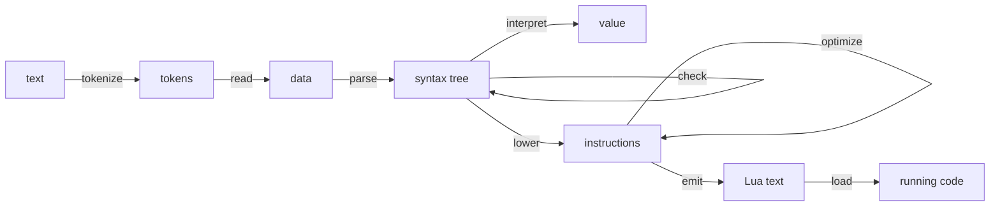

# Writing compilers in Mua

**A guide to writing compilers, interpreters and other language tools in Mua.** It builds one
compiler from text to running Lua, stage by stage, and stops at each stage to say what the
stage is for, what Mua offers it, and what to watch for. [The language](syntax.md) owns the
rules; [Designing and writing Mua](designing-and-writing-mua.md) owns the general design
method, which this guide applies to one kind of program.

A compiler is the program Mua is best at, for a reason worth stating first: a compiler is a
**closed set of shapes** (the kinds of syntax, the kinds of instruction) with an **open set of
operations** over them (checking, interpreting, lowering, optimizing, printing, emitting), and
Mua has a word for each side. `family` closes a set of `struct` kinds; a pass is a vocabulary of
handlers keyed by kind, checked against the family when it is made; vocabularies compose by
spread. The rest of this guide is that idea worked out.

The `lua` blocks below form one program, read top to bottom: `tests/guide.lua` translates and
runs them together, so a later block uses what an earlier one defined, and each is written as
`mua fmt` writes it. `examples/lisp.mua` is a shorter relative of the same compiler, without
source positions or collected errors.

* **Part I** (§1–§4) is the vocabulary: the shape of a compiler, and the three tools it is built
  from (families, passes, contexts).
* **Part II** (§5–§12) builds the compiler: reading, parsing, checking, interpreting, lowering,
  optimizing, emitting, and testing.
* **Part III** (§13–§16) is judgment: performance, open and closed sets, languages beyond a
  Lisp, and what this approach still lacks.

## 0. Forms this guide relies on

| Form | Used for |
|---|---|
| `family "description"` … `F { A, B }` | a closed set of struct kinds, declared first, sealed once its structs exist (§3) |
| `struct { field: Type }` | one kind: a nominal record with checked fields |
| `F.pass "description" with … end` | a function over the family: one handler per kind, checked when it is made (§4) |
| `define … end` | a vocabulary: the handlers of a pass, shared and extended by spread |
| `..Base` and an explicit entry | composition: a spread contributes entries, an explicit entry overrides; two spreads that offer one name clash unless an entry names it |
| `checker("name", test)` | a named predicate, for contracts the built-ins do not cover (§3.3) |
| `meta { index = … }` | a metatable from a vocabulary; here, scopes that fall back to the scope around them (§7) |
| `load(text, name)` | running the Lua a compiler emits (§11) |

## Part I: the vocabulary

## 1. The shape of a compiler

A compiler is a pipeline of representations. Each stage reads one and writes the next:



Three decisions shape everything else:

1. **Every representation is data.** A stage's output can be printed, compared, stored and fed
   to a test without running the stages after it. That is what makes a compiler debuggable:
   when the output is wrong, you look at each representation in turn until one is.
2. **Each representation is a closed set of kinds.** The syntax has so many kinds of
   expression; the instructions, so many kinds of instruction. Adding a kind is a language
   change, and every operation must learn it. A `family` makes that a checked fact (§3).
3. **Operations are open.** New passes arrive all the time: a new check, an optimization, a
   printer for debugging, a second back end. A pass is a vocabulary, so a new one never edits the
   kinds or the other passes (§4).

The second and third points are the two sides of the *expression problem*: in most languages
either new kinds or new operations are cheap, and the other is expensive. Here kinds are
deliberately expensive (each pass is told when one is missing) and operations are cheap (a
vocabulary and a word).

## 2. Stages, and where state lives

A stage is a function from one representation to the next. Inside a stage, the work is a walk
over a tree, and the walk usually needs **state**: the names in scope, the code being written,
a supply of fresh names, the problems found so far. There are two places to put it:

* **passed down**, as an argument the walk hands to each child: a scope, which an inner node
  extends without the outer one seeing it;
* **shared**, in a context table every node of the walk writes to: the code being emitted, the
  problems found.

Passes take both (§4.3): the arguments a pass is called with are passed on to each handler, and a
handler passes them, changed or not, to the calls it makes for its children. Keep the two kinds
apart in your head: an extended scope is a new value, a list of problems is one shared value
that grows.

## 3. Families: closed sets of kinds

### 3.1 Declaring a family

A family is declared first, so that its structs' fields can be typed with it, and sealed with
its kinds once they exist. Its name is a description: it appears in messages, so write what a
reader of an error should see.

```lua
-- a family of two kinds, to show the mechanism; the compiler's own families follow in §6 and §9
local Shape = family "shape"
local Circle = struct { radius: Number }
local Pair = struct { left: Shape, right: Shape }
Shape { Circle, Pair }

local both = Pair { left = Circle { radius = 1 }, right = Circle { radius = 2 } }
assert(Shape.is(both, Pair) and not Shape.is(both, Circle))
assert(table.concat(Shape.kinds, " ") == "Circle Pair")
```

The family is a checker: a field typed `Shape` refuses anything that is not one of its kinds,
and says so with the description:

```lua
local ok, message = pcall(Pair, { left = Circle { radius = 1 }, right = 5 })
assert(not ok and message:find("expects shape", 1, true))
```

`Shape.is(node, Kind)` asks a kind, and asking about a struct that is not a kind of the family is
an error rather than `false`, so a misspelled kind cannot quietly answer no.

### 3.2 Kinds are structs

Each kind is an ordinary `struct`: closed (a misspelled field is an error where the node is
built), typed (each field is checked), and nominal (a `Circle` is not a `Pair` with the same
fields). Build nodes only through their struct, and the tree is valid by construction: there is
no node of a kind the family does not know, and no field holding the wrong kind of thing.

Two habits pay off from the start:

* **Give every syntax node its source position** (an `at` field). Every later error needs one,
  and adding it afterwards touches every constructor.
* **Keep nodes free of behavior.** The operations live in passes; a node is its fields. That is
  what lets a node be printed, compared and rebuilt with a spread.

### 3.3 Lists of nodes

A struct field typed `Table` accepts any table. A list of nodes is better described with a
named checker, which `checker` makes from a predicate; `check(T, v)` asks any checker:

```lua
-- a list whose every element passes T, named for messages
local list_of =: T
    local every =: v
        if type v ~= "table" then return false end
        for _, x in ipairs v do
            if not check(T, x) then return false end
        end
        return true
    end
    return checker("list of " .. tostring T, every)
end
```

A checker that walks a list costs a pass over the list each time a node is built. That is cheap
for a compiler's trees; §13 says how to turn contracts off where it is not.

## 4. Passes: operations over a family

### 4.1 A pass is a vocabulary checked against the family

`F.pass "description" handlers` returns a function over the family's values. `handlers` has one
entry per kind, keyed by the struct's name. It is checked when the pass is made: a kind with no
handler, a handler for a name that is no kind, and a handler that is not a function are errors
that name them. So a pass that compiles has a handler for every kind, and a new kind makes every
pass that has not learned it fail where it is made, not when some program first uses the kind.

```lua
local Area = define
    Circle =: shape area
        return 3 * shape.radius * shape.radius
    end
    Pair =: shape area
        return area shape.left + area shape.right
    end
end
local area = Shape.pass "area" with ..Area end
assert(area both == 15)

local missing, why = pcall(Shape.pass "area", { Circle = Area.Circle })
assert(not missing and why:find("no handler for the kind 'Pair'", 1, true))
```

A handler is called as `handler(node, pass, ...)`. The second argument is the pass itself, to
recur with; the convention in this guide is to call it `go` when it is a walk.

### 4.2 Answers and effects

A pass either **answers** (each handler returns something: a value, a node, a line of text) or
**acts** (each handler changes a shared context and returns nothing). The compiler below has
both: the interpreter answers values, lowering answers registers and writes instructions, the
checker acts on a list of problems. Decide which a pass is before writing it, and keep it one or
the other; a handler that answers in one kind and acts in another is a bug waiting to happen.

### 4.3 Carrying state down the tree

The arguments a pass is called with follow the node to every handler. A handler passes them on
in its own calls, changed or not:

```lua
local Depth = define
    Circle =: shape go depth
        return depth
    end
    Pair =: shape go depth
        return math.max(go(shape.left, depth + 1), go(shape.right, depth + 1))
    end
end
local depth = Shape.pass "depth" with ..Depth end
assert(depth(both, 0) == 1)
```

### 4.4 Composing passes

Because handlers are a vocabulary, passes are built from one another by spread:

* **A base and its variants.** A shared base is spread in, and each variant names only the kinds
  it changes. The optimizer (§10) is five passes over one base that answers every instruction with
  itself.
* **An explicit entry overrides a spread.** That is the way to say "this pass does what that one
  does, except here".
* **Two spreads that offer the same kind clash** (`spread-overlap`) unless the block names that
  kind itself. Combining two passes that both handle a kind is a decision, and the clash makes
  you write it down.
* **A handler cannot be removed with `nil`**: in Lua, `nil` is absence, so `{ ..Base, Kind = nil }`
  keeps the base's handler. Copy the vocabulary and delete the entry, and the pass will tell you
  the kind is now missing.

```lua
-- a variant that names only what it changes
local Rounded = define ..Area
    Circle =: shape area
        return math.floor(3.14159 * shape.radius * shape.radius)
    end
end
local rounded = Shape.pass "rounded area" with ..Rounded end
assert(rounded both == 15)
```

## Part II: building a compiler

The language is a small Lisp: numbers, names, `(+ a b)` and the other binary operators,
`(if test yes no)`, `(let ((name value) …) body)` (a binding sees itself, so a function can
recur), `(lambda (name …) body)`, calls, and a program of `(define name value)` forms ending in
an expression. The target is Lua text.

## 5. Reading text

### 5.1 Tokens carry positions

The tokenizer is the one place that knows where things are in the text. Every token records its
position, as `file:line:column`, and every stage after it passes positions on.

```lua
local Token = struct { text: String, at: String }

local tokenize =: text name
    local tokens, i, line, line_start = {}, 1, 1, 1
    while i <= #text do
        local c = text:sub(i, i)
        if c == "\n" then
            line, line_start = line + 1, i + 1
            i += 1
        elseif c:match "%s" then
            i += 1
        elseif c == ";" then
            -- a comment runs to the end of its line
            i = text:find("\n", i, true) or #text + 1
        else
            local stop = i
            if c ~= "(" and c ~= ")" then stop = (text:find("[%s();]", i) or #text + 1) - 1 end
            local at = ("%s:%d:%d"):format(name, line, i - line_start + 1)
            tokens[#tokens + 1] = Token { text = text:sub(i, stop), .at }
            i = stop + 1
        end
    end
    return tokens
end
```

### 5.2 Reading into data

A Lisp reads in two steps: tokens to *data* (atoms and lists), then data to syntax (§6). The
first step knows only brackets; the second knows the language. Keeping them apart means the
reader never changes when the language does. The data are a family too, so the parser can ask
`Datum.is`.

```lua
local Datum = family "datum"
local Atom = struct { text: String, at: String }
local List = struct { items: Table, at: String }
Datum { Atom, List }

-- an error at a position: every stage reports this way
local fail = |at, message| -> error(at .. ": " .. message, 0)

local read =: tokens
    local position = 1
    local datum
    datum = do()
        local token = tokens[position]
        position += 1
        if token.text == ")" then fail(token.at, "this ) closes nothing") end
        if token.text ~= "(" then return Atom { text = token.text, at = token.at } end
        local items = {}
        while true do
            local next_token = tokens[position]
            if next_token == nil then fail(token.at, "this ( is never closed") end
            if next_token.text == ")" then break end
            items[#items + 1] = datum()
        end
        position += 1
        return List { .items, at = token.at }
    end
    local forms = {}
    while tokens[position] do forms[#forms + 1] = datum() end
    return forms
end
```

The error names the opening bracket's position, not the end of the text: the place to fix is
where the list began.

## 6. The syntax tree, and parsing

### 6.1 The family

```lua
local Expr = family "expression"
local Exprs = list_of Expr
local Num = struct { value: Number, at: String }
local Var = struct { name: String, at: String }
local Prim = struct { op: String, args: Exprs, at: String }
local If = struct { test: Expr, yes: Expr, no: Expr, at: String }
local Let = struct { name: String, value: Expr, body: Expr, at: String }
local Lambda = struct { params: Table, body: Expr, at: String }
local Apply = struct { fn: Expr, args: Exprs, at: String }
Expr { Num, Var, Prim, If, Let, Lambda, Apply }

-- the operators the language knows, and what each means
local operators = {
    ["+"] = |a, b| -> a + b,
    ["-"] = |a, b| -> a - b,
    ["*"] = |a, b| -> a * b,
    ["<"] = |a, b| -> a < b,
    ["="] = |a, b| -> a == b,
}
```

Two choices are visible here. `let` desugars to nested `Let` nodes of one binding each, so the
rest of the compiler meets one form instead of two. And `operators` is a table of meanings shared
by the parser (which operators exist), the interpreter (what they do) and the optimizer (what they
compute when the operands are known): one definition, three uses.

### 6.2 Parsing data into the family

Parsing is a function over data, not a pass: what a list means depends on its first element, not
on its kind. Each form checks its own shape and fails at its own position.

```lua
local parse
parse =: d
    if Datum.is(d, Atom) then
        local number = tonumber d.text
        if number then return Num { value = number, at = d.at } end
        return Var { name = d.text, at = d.at }
    end
    local items = d.items
    if #items == 0 then fail(d.at, "() is not an expression") end
    local head = Datum.is(items[1], Atom) and items[1].text
    if head == "if" then
        if #items ~= 4 then fail(d.at, "(if test yes no) takes three parts") end
        return If { test = parse items[2], yes = parse items[3], no = parse items[4], at = d.at }
    end
    if head == "let" then
        if #items ~= 3 or not Datum.is(items[2], List) then fail(d.at,
                "a let is (let ((name value) …) body)") end
        local body = parse items[3]
        local bindings = items[2].items
        for i = #bindings, 1, -1 do
            local b = bindings[i]
            if not Datum.is(b, List) or #b.items ~= 2 or not Datum.is(b.items[1], Atom) then
                fail(b.at, "a binding is (name value)")
            end
            body = Let { name = b.items[1].text, value = parse b.items[2], .body, at = b.at }
        end
        return body
    end
    if head == "lambda" then
        if #items ~= 3 or not Datum.is(items[2], List) then fail(d.at,
                "a lambda is (lambda (name …) body)") end
        local params = {}
        for i, p in ipairs items[2].items do
            if not Datum.is(p, Atom) then fail(p.at, "a parameter is a name") end
            params[i] = p.text
        end
        return Lambda { .params, body = parse items[3], at = d.at }
    end
    local args = {}
    for i = 2, #items do args[#args + 1] = parse items[i] end
    if operators[head] then return Prim { op = head, .args, at = d.at } end
    return Apply { fn = parse items[1], .args, at = d.at }
end

-- a program: (define name value) forms, then the expression they are for
local parse_program =: forms
    if #forms == 0 then error("parse: an empty program", 0) end
    local body = parse forms[#forms]
    for i = #forms - 1, 1, -1 do
        local form = forms[i]
        local items = Datum.is(form, List) and form.items
        if not items or #items ~= 3 or not Datum.is(items[1], Atom) or items[1].text ~= "define" then
            fail(form.at, "only the last form of a program may be an expression")
        end
        body = Let { name = items[2].text, value = parse items[3], .body, at = form.at }
    end
    return body
end
```

Parsing reports the **first** problem and stops: a malformed form says nothing reliable about
what follows it. Checking (§7) can do better.

### 6.3 Printing the tree back

The first pass to write over a new family is the one that prints it. It is how every other
stage is debugged, and it gives the tree a round-trip test: printing a parsed program and reading
the print must give the same tree.

```lua
local Print = define
    Num =: n go
        return tostring n.value
    end
    Var =: n go
        return n.name
    end
    Prim =: n go
        return "(" .. n.op .. " " .. go n.args[1] .. " " .. go n.args[2] .. ")"
    end
    If =: n go
        return "(if " .. go n.test .. " " .. go n.yes .. " " .. go n.no .. ")"
    end
    Let =: n go
        return "(let ((" .. n.name .. " " .. go n.value .. ")) " .. go n.body .. ")"
    end
    Lambda =: n go
        return "(lambda (" .. table.concat(n.params, " ") .. ") " .. go n.body .. ")"
    end
    Apply =: n go
        local parts = { go n.fn }
        for _, arg in ipairs n.args do parts[#parts + 1] = go arg end
        return "(" .. table.concat(parts, " ") .. ")"
    end
end
local print_expr = Expr.pass "print an expression" with ..Print end

local parsed = parse_program(read(tokenize("(let ((x 2)) (* x (+ x 1)))", "round-trip")))
local printed = print_expr parsed
assert(printed == "(let ((x 2)) (* x (+ x 1)))")
assert(print_expr(parse_program(read(tokenize(printed, "again")))) == printed)
```

## 7. Checking

### 7.1 Scopes that fall back

A checker walks the tree carrying the names in scope. Entering a `let` or a `lambda` makes an
inner scope; leaving it must restore the outer one. Copying the whole scope at each entry works
but costs a copy per binding. A scope that **falls back** to the one around it costs nothing:
`meta { index = outer }` makes a metatable whose `__index` is the outer scope, so a name missing
from the inner table is looked up outside.

```lua
-- a scope whose missing names are those of the scope around it
local within = outer -> meta { index = outer } {}
local scope_with =: outer names
    local inner = within outer
    for _, name in ipairs names do inner[name] = true end
    return inner
end

local outer = scope_with({}, { "x" })
local inner = scope_with(outer, { "y" })
assert(inner.x and inner.y and not outer.y)
```

The same scopes serve the interpreter (§8), holding values instead of `true`.

### 7.2 Collecting problems

A checker should report **every** problem it can, not the first: a programmer fixing a program
wants the whole list. So the checker acts on a shared list of problems instead of raising an
error, and the compiler stops after checking if the list is not empty. The scope is passed down
(each handler may extend it); the list is shared (every handler appends to the same one).

```lua
local report =: problems at message
    problems[#problems + 1] = at .. ": " .. message
end

local Check = define
    Num =: n go scope problems
        return
    end
    Var =: n go scope problems
        if not scope[n.name] then report(problems, n.at, n.name .. " is not defined here") end
    end
    Prim =: n go scope problems
        if #n.args ~= 2 then report(problems,
                n.at, ("(%s) takes two arguments, got %d"):format(n.op, #n.args)) end
        for _, arg in ipairs n.args do go(arg, scope, problems) end
    end
    If =: n go scope problems
        go(n.test, scope, problems)
        go(n.yes, scope, problems)
        go(n.no, scope, problems)
    end
    Let =: n go scope problems
        local inner = scope_with(scope, { n.name })
        go(n.value, inner, problems)
        go(n.body, inner, problems)
    end
    Lambda =: n go scope problems
        go(n.body, scope_with(scope, n.params), problems)
    end
    Apply =: n go scope problems
        go(n.fn, scope, problems)
        for _, arg in ipairs n.args do go(arg, scope, problems) end
    end
end
local check = Expr.pass "check names and arity" with ..Check end

local problems = {}
check(parse_program(read(tokenize("(+ x (* 1))", "two problems"))), {}, problems)
assert(#problems == 2)
assert(problems[1] == "two problems:1:4: x is not defined here")
assert(problems[2] == "two problems:1:6: (*) takes two arguments, got 1")
```

The problems arrive in the order of the walk, which is the order of the text. Both were found in
one run: the unknown `x`, and the `(*)` with one argument. A checker that stopped at the first
would have made the programmer run it twice.

A checker is also where a language's static rules live as it grows: types, mutability, effects.
Each is a pass of its own, or a richer context in this one; none of them needs the others to
change.

## 8. A reference interpreter

Before compiling anything, write an interpreter: a pass that answers the value of each node. It
is short, obviously right, and it becomes the **reference** every compiled program is compared
with (§12). A compiler without one can only be tested against expected outputs written by hand.

```lua
local Interpret = define
    Num = do(n, go, env)
        return n.value
    end
    Var = do(n, go, env)
        return env[n.name]
    end
    Prim = do(n, go, env)
        return operators[n.op](go(n.args[1], env), go(n.args[2], env))
    end
    If = do(n, go, env)
        if go(n.test, env) then return go(n.yes, env) end
        return go(n.no, env)
    end
    Let = do(n, go, env)
        local inner = within env
        inner[n.name] = go(n.value, inner)
        return go(n.body, inner)
    end
    Lambda = do(n, go, env)
        return do(..values)
            local inner = within env
            for i, name in ipairs n.params do inner[name] = values[i] end
            return go(n.body, inner)
        end
    end
    Apply = do(n, go, env)
        local values = {}
        for i, arg in ipairs n.args do values[i] = go(arg, env) end
        return go(n.fn, env)(unpack values)
    end
end
local interpret = Expr.pass "interpret an expression" with ..Interpret end

local source = "(define fact (lambda (n) (if (< n 2) 1 (* n (fact (- n 1)))))) (fact 5)"
assert(interpret(parse_program(read(tokenize(source, "fact"))), {}) == 120)
```

`Let` binds the name in the inner scope *before* evaluating the value into it, so a `lambda`
bound by a `let` sees itself: that is the whole of recursion here. The interpreter decides the
semantics; the compiler's job is to agree with it, faster.

## 9. Lowering to an intermediate form

### 9.1 Why a second family

The syntax tree is the language as written: nested, with names. A back end wants the program as
it runs: a sequence of simple steps, with every intermediate value named. The **intermediate
form** (IR) is a second family, chosen so that optimizations and emission are easy:

* **registers**: every value has a name (`t3`), written once where it is computed;
* **flat code**: each function is one list of instructions, with labels and jumps for control;
* **closures** hold the code of the function they create.

```lua
local Instr = family "instruction"
local Const = struct { dst: String, value: Any }
local Copy = struct { dst: String, src: String }
local Op = struct { dst: String, op: String, left: String, right: String }
local Call = struct { dst: String, fn: String, args: Table }
local Label = struct { name: String }
local Jump = struct { target: String }
local JumpUnless = struct { test: String, target: String }
local Return = struct { src: String }
local Closure = struct { dst: String, params: Table, code: Table }
Instr { Const, Copy, Op, Call, Label, Jump, JumpUnless, Return, Closure }
```

Write down the IR's **invariants**, because the optimizer will rely on them and a later change
to lowering can break them silently. Here: jumps only go forward (there are no loops, only
recursion through calls); a label is reached by a jump or by falling through; a register named by
a `let` or an `if` may be written in more than one place, all other registers exactly once.

### 9.2 The lowering context

Lowering is a pass over the *syntax* family that writes *instructions*. Its context holds the
code being written, the register each name stands for, and a supply of fresh names. A handler
answers the register holding its node's value.

```lua
local fresh_names = do()
    local count = 0
    return: prefix
        count += 1
        return prefix .. count
    end
end

local emit =: ctx instr
    ctx.code[#ctx.code + 1] = instr
end
```

A nested scope is a context whose `env` falls back to the outer one, and a function body is a
context with its own code list: both are a spread of the outer context with a field replaced.
The fresh-name supply is shared by every context, so names never collide across functions.

### 9.3 The lowering pass

```lua
local Lower = define
    Num =: n go ctx
        local dst = ctx.fresh "t"
        emit(ctx, Const { .dst, value = n.value })
        return dst
    end
    Var =: n go ctx
        return ctx.env[n.name]
    end
    Prim =: n go ctx
        local left, right = go(n.args[1], ctx), go(n.args[2], ctx)
        local dst = ctx.fresh "t"
        emit(ctx, Op { .dst, op = n.op, .left, .right })
        return dst
    end
    If =: n go ctx
        local test = go(n.test, ctx)
        local otherwise, done, dst = ctx.fresh "else", ctx.fresh "end", ctx.fresh "t"
        emit(ctx, JumpUnless { .test, target = otherwise })
        emit(ctx, Copy { .dst, src = go(n.yes, ctx) })
        emit(ctx, Jump { target = done })
        emit(ctx, Label { name = otherwise })
        emit(ctx, Copy { .dst, src = go(n.no, ctx) })
        emit(ctx, Label { name = done })
        return dst
    end
    Let =: n go ctx
        local register = ctx.fresh "v"
        local inner = { ..ctx, env = within ctx.env }
        inner.env[n.name] = register
        emit(ctx, Copy { dst = register, src = go(n.value, inner) })
        return go(n.body, inner)
    end
    Lambda =: n go ctx
        local inner = { ..ctx, code = {}, env = within ctx.env }
        local params = {}
        for i, name in ipairs n.params do
            params[i] = ctx.fresh "p"
            inner.env[name] = params[i]
        end
        emit(inner, Return { src = go(n.body, inner) })
        local dst = ctx.fresh "f"
        emit(ctx, Closure { .dst, .params, code = inner.code })
        return dst
    end
    Apply =: n go ctx
        local fn = go(n.fn, ctx)
        local args = {}
        for i, arg in ipairs n.args do args[i] = go(arg, ctx) end
        local dst = ctx.fresh "t"
        emit(ctx, Call { .dst, .fn, .args })
        return dst
    end
end
local lower = Expr.pass "lower an expression to instructions" with ..Lower end

-- a whole program is the body of a function with no parameters
local lower_program =: ast
    local ctx = { code = {}, env = {}, fresh = fresh_names() }
    emit(ctx, Return { src = lower(ast, ctx) })
    return ctx.code
end
```

Read `If` as the template for control flow: evaluate the test, jump over the branch that does not
run, copy each branch's value into one register, and meet at a label. Every structured construct
lowers to this pattern of labels and jumps.

`Let` writes its register *after* lowering the value, but the value's code already refers to the
register (a recursive call does): the emitted Lua declares every register at the top of its
function (§11), so a closure can capture a register before it is written.

## 10. Optimizing

### 10.1 Rewrites and walks

An optimization is a pass over the instruction family. Two drivers cover them all:

* a **rewrite** answers each instruction with the list of instructions that replace it (none to
  delete it, one to keep or change it, several to expand it);
* a **walk** visits each instruction for its effect on a context (counting, collecting).

```lua
local rewrite =: pass code ctx
    local out = {}
    ctx.out = out
    for _, instr in ipairs code do
        for _, result in ipairs(pass(instr, ctx)) do out[#out + 1] = result end
    end
    return out
end
local walk =: pass code ctx
    for _, instr in ipairs code do pass(instr, ctx) end
end
```

A rewrite exposes the code written so far as `ctx.out`, so a handler can look one instruction
back (§10.4 uses it).

### 10.2 The identity, and passes that change only what they name

Every rewrite starts from the identity: each instruction stands for itself. Spread in, it lets an
optimization name only the kinds it changes, and the family still checks that the result covers
every kind.

```lua
local keep = n -> { n }
local Keep = define
    Const = keep
    Copy = keep
    Op = keep
    Call = keep
    Label = keep
    Jump = keep
    JumpUnless = keep
    Return = keep
    Closure = keep
end
local ignore = do() end
```

### 10.3 Folding what is known

Along straight-line code, a register written by a `Const` holds a known value, and an operation
on known values can be computed now. Facts are boxed (`{ value }`) because a known value may be
`false`. The invariants of §9.1 make this sound: at a **label**, control may arrive from
elsewhere, so everything known is forgotten; a function body starts knowing nothing. A test that
is known decides its jump: a true test never jumps, a false one always does.

```lua
local Fold = define ..Keep
    Const =: n go ctx
        ctx.known[n.dst] = { n.value }
        return { n }
    end
    Copy =: n go ctx
        local known = ctx.known[n.src]
        ctx.known[n.dst] = known
        if known then return { Const { dst = n.dst, value = known[1] } } end
        return { n }
    end
    Op =: n go ctx
        local left, right = ctx.known[n.left], ctx.known[n.right]
        ctx.known[n.dst] = nil
        if left and right then
            local value = operators[n.op](left[1], right[1])
            ctx.known[n.dst] = { value }
            return { Const { dst = n.dst, .value } }
        end
        return { n }
    end
    Call =: n go ctx
        ctx.known[n.dst] = nil
        return { n }
    end
    Label =: n go ctx
        ctx.known = {}
        return { n }
    end
    JumpUnless =: n go ctx
        local test = ctx.known[n.test]
        if test == nil then return { n } end
        if test[1] then return {} end
        return { Jump { target = n.target } }
    end
    Closure =: n go ctx
        ctx.known[n.dst] = nil
        return { Closure with
            dst = n.dst
            params = n.params
            code = rewrite(go, n.code, { known = {} })
        end }
    end
end
local fold = Instr.pass "fold what is known" with ..Fold end
```

If the language grows loops, jumps go backwards and "forget at labels" is no longer enough: a
fact known before a loop may be changed inside it. Then folding needs a dataflow analysis over
the function's control-flow graph. The invariant written down in §9.1 is what tells you this
optimization has to change.

### 10.4 Removing what cannot run

After folding, some jumps always happen and some labels are never jumped to. Code between an
unconditional jump (or a return) and the next label that is still a target can never run.
Finding the targets is a walk; removing the dead code is a rewrite that carries a "dead" flag
along the code. A jump to the label right after it is no jump, which the rewrite removes by
looking back at the code it has written.

```lua
local Targets = define
    Const = ignore
    Copy = ignore
    Op = ignore
    Call = ignore
    Label = ignore
    Return = ignore
    Jump =: n go targets
        targets[n.target] = true
    end
    JumpUnless =: n go targets
        targets[n.target] = true
    end
    Closure =: n go targets
        walk(go, n.code, targets)
    end
end
local targets_of = Instr.pass "find the labels still jumped to" with ..Targets end

local live =: n go ctx
    if ctx.dead then return {} end
    return { n }
end
local ends_block =: n go ctx
    if ctx.dead then return {} end
    ctx.dead = true
    return { n }
end
local Reach = define
    Const = live
    Copy = live
    Op = live
    Call = live
    JumpUnless = live
    Jump = ends_block
    Return = ends_block
    Label =: n go ctx
        if not ctx.targets[n.name] then return {} end
        local last = ctx.out[#ctx.out]
        if last and Instr.is(last, Jump) and last.target == n.name then ctx.out[#ctx.out] = nil end
        ctx.dead = false
        return { n }
    end
    Closure =: n go ctx
        if ctx.dead then return {} end
        return { Closure with
            dst = n.dst
            params = n.params
            code = rewrite(go, n.code, { targets = ctx.targets })
        end }
    end
end
local reach = Instr.pass "drop what cannot run" with ..Reach end
```

### 10.5 Removing what nobody reads

An instruction with no effect whose register is never read can go. Counting reads is a walk;
removing is a rewrite over the identity that names the pure kinds. A call may have effects, so it
stays. Reads inside a closure count, since the closure may read a register of the function around
it.

```lua
local reading =: register ctx
    ctx.reads[register] = (ctx.reads[register] or 0) + 1
end
local Reads = define
    Const = ignore
    Label = ignore
    Jump = ignore
    Copy =: n go ctx
        reading(n.src, ctx)
    end
    Op =: n go ctx
        reading(n.left, ctx)
        reading(n.right, ctx)
    end
    Call =: n go ctx
        reading(n.fn, ctx)
        for _, arg in ipairs n.args do reading(arg, ctx) end
    end
    JumpUnless =: n go ctx
        reading(n.test, ctx)
    end
    Return =: n go ctx
        reading(n.src, ctx)
    end
    Closure =: n go ctx
        walk(go, n.code, ctx)
    end
end
local reads_of = Instr.pass "count the reads of each register" with ..Reads end

local unread =: n ctx
    return (ctx.reads[n.dst] or 0) == 0
end
local pure =: n go ctx
    if unread(n, ctx) then return {} end
    return { n }
end
local Sweep = define ..Keep
    Const = pure
    Copy = pure
    Op = pure
    Closure =: n go ctx
        if unread(n, ctx) then return {} end
        return { Closure { dst = n.dst, params = n.params, code = rewrite(go, n.code, ctx) } }
    end
end
local sweep = Instr.pass "sweep what nobody reads" with ..Sweep end
```

### 10.6 Running to a fixed point

One optimization exposes another: folding a test makes a branch dead, removing it makes a
register unread, removing that makes another unread. The optimizer runs the passes in order until
the code stops shrinking, with a bound so a mistake cannot loop forever.

```lua
local size
size =: code
    local total = 0
    for _, instr in ipairs code do
        total += 1
        if Instr.is(instr, Closure) then total += size instr.code end
    end
    return total
end

local optimize =: code
    for _ = 1, 8 do
        local before = size code
        code = rewrite(fold, code, { known = {} })
        local targets = {}
        walk(targets_of, code, targets)
        code = rewrite(reach, code, { .targets })
        local reads = {}
        walk(reads_of, code, { .reads })
        code = rewrite(sweep, code, { .reads })
        if size code == before then break end
    end
    return code
end
```

## 11. Emitting Lua

Emission is a pass over the instructions that answers text. Three facts about Lua decide its
shape:

* **`goto` may not jump into the scope of a local.** So each function declares every register it
  writes at its top, before any label, and the instructions only assign.
* **Lua's truthiness is the language's**: only `false` and `nil` are false. The Lisp here adopts
  it, so `if` needs no translation. A language with other rules (0 is false, say) must emit a
  test that says so.
* **Operators differ in spelling**: the language's `=` is Lua's `==`.

```lua
local function_body =: go code indent
    local names, seen = {}, {}
    for _, instr in ipairs code do
        local dst = instr.dst
        if dst and not seen[dst] then
            seen[dst] = true
            names[#names + 1] = dst
        end
    end
    local lines = {}
    if #names > 0 then lines[1] = indent .. "local " .. table.concat(names, ", ") end
    for _, instr in ipairs code do lines[#lines + 1] = go(instr, indent) end
    return table.concat(lines, "\n")
end

local lua_operators = {["="] = "==" }
local EmitLua = define
    Const =: n go indent
        return indent .. n.dst .. " = " .. tostring n.value
    end
    Copy =: n go indent
        return indent .. n.dst .. " = " .. n.src
    end
    Op =: n go indent
        return indent .. n.dst .. " = " .. n.left .. " " .. (lua_operators[n.op] or n.op) .. " " .. n.right
    end
    Call =: n go indent
        return indent .. n.dst .. " = " .. n.fn .. "(" .. table.concat(n.args, ", ") .. ")"
    end
    Label =: n go indent
        return indent .. "::" .. n.name .. "::"
    end
    Jump =: n go indent
        return indent .. "goto " .. n.target
    end
    JumpUnless =: n go indent
        return indent .. "if not " .. n.test .. " then goto " .. n.target .. " end"
    end
    Return =: n go indent
        return indent .. "return " .. n.src
    end
    Closure =: n go indent
        return indent .. n.dst .. " = function(" .. table.concat(n.params, ", ") .. ")\n"
        .. function_body(go, n.code, indent .. "  ") .. "\n" .. indent .. "end"
    end
end
local emit_instr = Instr.pass "write an instruction as Lua" with ..EmitLua end
local emit_lua = code -> function_body(emit_instr, code, "")
```

The whole compiler is the stages in order. It answers every representation, not only the last,
so a test or a debugging session can look at any of them:

```lua
local compile =: text name
    local ast = parse_program(read(tokenize(text, name)))
    local problems = {}
    check(ast, {}, problems)
    if #problems > 0 then error(table.concat(problems, "\n"), 0) end
    local ir = lower_program ast
    local optimized = optimize ir
    return { .ast, .ir, .optimized, lua = emit_lua optimized }
end

local run_compiled =: text name
    local compiled = compile(text, name)
    return assert(load(compiled.lua, "=" .. name))(), compiled
end

local folded = compile("(if (< 1 2) (+ 10 (* 2 3)) 99)", "folded")
assert(size folded.ir == 16 and size folded.optimized == 2)
assert(folded.lua == "local t6\nt6 = 16\nreturn t6")
```

`load` takes a chunk name: give each compiled program its own (`"=" .. name`), so a Lua error in
compiled code names the program it came from. The emitted text is the place to look when a
compiled program misbehaves; print it.

## 12. Testing a compiler

### 12.1 Agree with the interpreter

The strongest test is **differential**: run each program both ways and require the same answer.
Every new program in the corpus tests the whole pipeline, and a disagreement points at a stage:
if the unoptimized code agrees and the optimized code does not, the optimizer is wrong.

```lua
local corpus = {
    { "arithmetic", "(+ 1 (* 2 3))", 7 },
    { "a known branch", "(if (< 1 2) (+ 10 (* 2 3)) 99)", 16 },
    { "an unknown branch", "(define f (lambda (x) (if (< x 0) (- 0 x) x))) (f (- 0 4))", 4 },
    { "a function", "(define square (lambda (x) (* x x))) (square (+ 3 4))", 49 },
    { "recursion",
        "(define fact (lambda (n) (if (< n 2) 1 (* n (fact (- n 1)))))) (fact 10)", 3628800 },
    { "a closure", "(define adder (lambda (a) (lambda (b) (+ a b)))) ((adder 3) 4)", 7 },
    { "let", "(let ((x 2) (y (+ x 1))) (* x y))", 6 },
    { "equality", "(if (= (+ 1 1) 2) 1 0)", 1 },
}
for _, case in ipairs corpus do
    local name, text, expected = case[1], case[2], case[3]
    local compiled, details = run_compiled(text, name)
    local unoptimized = assert(load(emit_lua details.ir, "=" .. name))()
    local interpreted = interpret(details.ast, {})
    assert(compiled == expected and unoptimized == expected and interpreted == expected, name)
end
```

### 12.2 Refusals are part of the language

What a compiler refuses, and how it says so, is as much its behavior as what it accepts. Test the
messages, positions included:

```lua
local refusal =: text
    local ok, message = pcall(compile, text, "refusal")
    assert(not ok, text .. " was accepted")
    return message
end
assert(refusal "(+ 1 2" == "refusal:1:1: this ( is never closed")
assert(refusal "(if 1 2)" == "refusal:1:1: (if test yes no) takes three parts")
assert(refusal "(let ((x)) x)" == "refusal:1:7: a binding is (name value)")
assert(refusal "(f 1)" == "refusal:1:2: f is not defined here")
assert(refusal "1 2" == "refusal:1:1: only the last form of a program may be an expression")
```

### 12.3 Other tests worth having

* **Round trips.** Printing a tree and reading it back gives the same tree (§6.3).
* **Representations at each stage.** For a few small programs, compare the IR before and after
  optimizing with what you expect; they are the tests that keep an optimization from silently
  stopping (the `16 -> 2` assertion in §11 is one).
* **Pass completeness.** A family checks every pass when it is made, so a new kind is caught by
  simply loading the compiler. Load it in the tests.
* **Examples with their output.** A file of programs whose expected output is a comment at the
  end, run by the test suite, documents and tests at once (Mua's `examples/` work this way).

## Part III: judgment

## 13. Performance

* **Dispatch is cheap.** A pass finds a handler by the node's metatable: one table lookup, no
  string comparison.
* **Contracts cost.** Each struct construction checks its fields, and a `list_of` checker walks
  its list. For a compiler's own trees this is usually invisible next to the work; where it is
  not, the translator's `contracts = false` removes the checks, and the program is otherwise the
  same. Keep contracts on in tests.
* **Spreads copy.** `{ ..ctx, code = {} }` copies the context; it is meant for entering a scope or a
  function, not for every node. Scopes that fall back (§7.1) cost nothing to enter.
* **The emitted code is ordinary Lua.** Registers become locals; LuaJIT compiles them well.
  Locals are limited to 200 per function, so a back end for large functions must reuse
  registers (allocate them by liveness) instead of declaring one per value.
* **Measure the compiler on large inputs** before optimizing it; the stages above are linear in
  the program except the fixed-point loop, which is bounded.

## 14. Open and closed sets

| You have | Use | Because |
|---|---|---|
| a fixed set of kinds, many operations | `family` and passes | each pass is checked to cover every kind |
| a fixed set of alternatives carrying one value each | `oneof` and a match | a match is checked exhaustive at every call |
| an open set of kinds, each bringing its own behavior | `meta` per kind (`examples/variants.mua`) | a new kind needs no change elsewhere, and no check covers it |
| an open set of named codes | a vocabulary (`{ get = 1, post = 2 }`) | anyone may extend it by spread |

Compilers sit firmly in the first row: the language's kinds are fixed, and operations multiply.
Resist making a pass tolerant of unknown kinds with a default handler: the check that every kind
is handled is the reason to use a family. Where most kinds pass through unchanged, spread the
identity (§10.2): every kind is still named, by the base.

Adding a kind is then a mechanical, checked change: add the struct, add it to the family, and
load the compiler. Every pass that has not learned the kind fails, by name, until it does.

## 15. Beyond a Lisp

The Lisp reads data and then parses it because its syntax is data. Other languages differ only in
the first two stages:

* **A language with its own syntax** needs a real parser in place of `read` and `parse`: a
  tokenizer that knows the language's tokens, and a recursive-descent parser that builds the
  same kind of family. Precedence climbing handles operators. Everything from checking on is
  unchanged.
* **A language that extends Mua** need not parse at all. Mua's parser takes a host (syntax §8):
  the host gives the typed forms and other forms meaning, receives parsed nodes, and emits Lua.
  Nua is such a host: its front end is a Mua host that turns Mua's syntax tree into a
  specializing compiler's input. Write a host when your language reads like Mua; write a parser
  when it does not.
* **A language staged in Lua** can skip emission to text: a pass can answer Lua closures directly
  (the interpreter is one), and `load` is for when the generated code must be inspected, cached
  or specialized further.

Mua itself is built the way this guide describes, without families: a lexer, a parser to a tree of
tagged nodes, a scope analysis, and an emitter that writes Lua.

## 16. What this approach still lacks

Writing this compiler surfaced several primitives, and some were added to Mua because of it:
`family` itself, `checker` for named predicates, passes that carry extra arguments, and the rule
that an explicit entry settles a clash between two spreads. Others are still written by hand in
each compiler, and are candidates for a library or the runtime:

* **The identity rewrite.** `Keep` (§10.2) lists every kind of the family by hand. A family could
  offer it, so that a new kind needs no edit there.
* **The two drivers.** `rewrite` and `walk` (§10.1) are the same in every compiler.
* **Lists of nodes.** `list_of` (§3.3) is a checker every family wants.
* **Positions and diagnostics.** The `at` strings, `fail` and `report` are conventions. A source
  span type and a diagnostics list with sorting and context lines would be shared by every tool.
* **Nested patterns.** A handler can ask `Instr.is(last, Jump)`, but it cannot match a shape
  (`Op` whose left is a known `Const`) in one expression. Optimizations written as patterns read
  far better than chains of tests.
* **Source maps.** A runtime error in compiled code names a line of emitted Lua, not of the
  source. Instructions could carry the source position of the node that produced them, and the
  emitted chunk a table from its lines back to them.

None of these is needed to write a compiler; each removes a piece of boilerplate or a class of
mistake. Add them when a second compiler wants the same thing.
